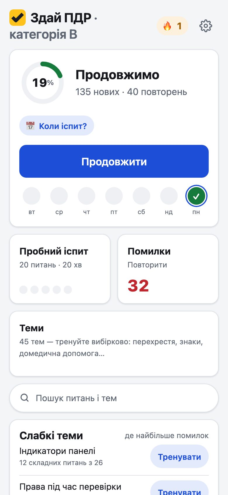
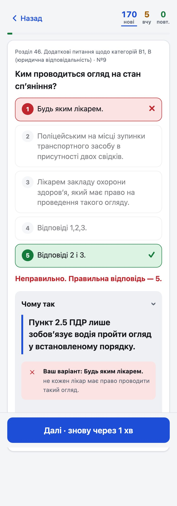
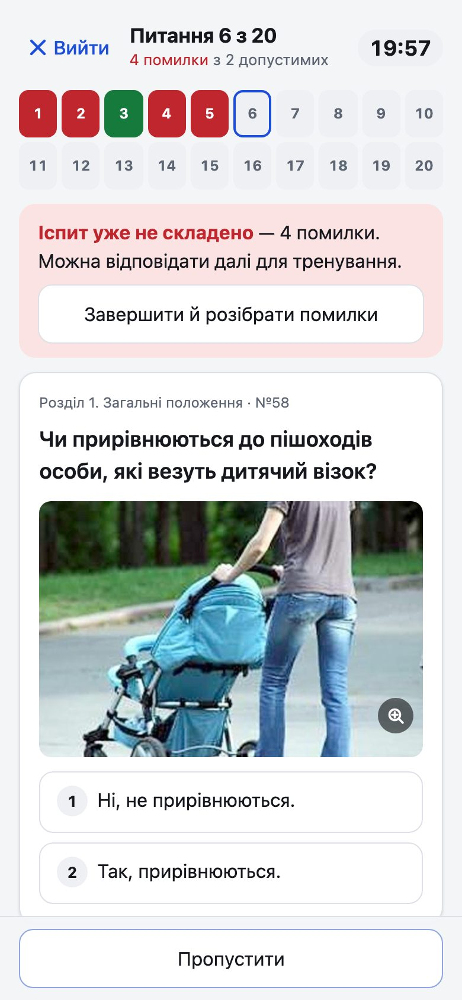
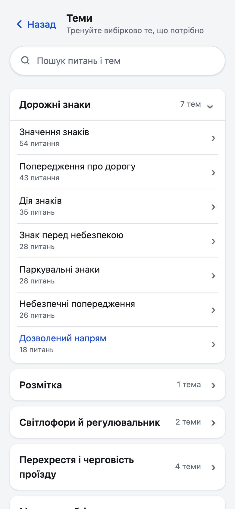
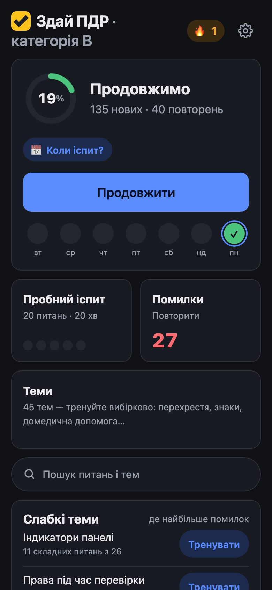
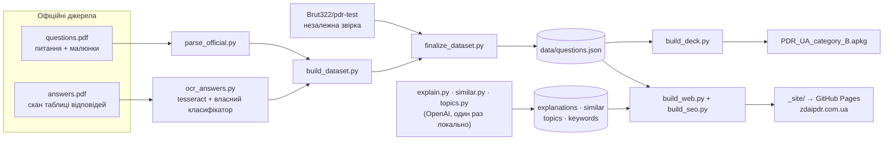

<p align="center">
  <a href="https://zdaipdr.com.ua/">
    <picture>
      <source media="(prefers-color-scheme: dark)" srcset="brand/zdaipdr-horizontal-reversed.svg">
      
    </picture>
  </a>
</p>

<h3 align="center">Тести ПДР України для категорії B: усі 1762 питання ГСЦ МВС, інтервальні повторення FSRS і пробний іспит</h3>

<p align="center">
  <a href="https://zdaipdr.com.ua/"></a>
  <a href="https://ankiweb.net/shared/info/1194338664"></a>
</p>

<p align="center">
  <a href="https://github.com/punjet/PDRAnkiDeck/actions/workflows/pages.yml"></a>
  
  
  <a href="LICENSE"></a>
</p>

<p align="center">
  <b><a href="https://zdaipdr.com.ua/">👉 Відкрити тренажер — zdaipdr.com.ua</a></b><br>
  Безкоштовно, без реклами й реєстрації. Працює офлайн і встановлюється на телефон.
</p>

<p align="center">
  
  
  
  
  
</p>

Проєкт має дві частини з одним джерелом даних:

- **сайт [zdaipdr.com.ua](https://zdaipdr.com.ua/)** — тренажер у браузері (PWA);
- **колода Anki** — ті самі питання в тому самому порядку, [на AnkiWeb](https://ankiweb.net/shared/info/1194338664) і в [Releases](https://github.com/punjet/PDRAnkiDeck/releases).

Питання й малюнки взяті з офіційної бази ГСЦ МВС (**наказ № 225 від 29.10.2025**, розділи 1–39 і 44–47). Кожна відповідь категорії B перевірена трьома незалежними способами.

## Зміст

- [Можливості сайту](#можливості-сайту)
- [Як це влаштовано](#як-це-влаштовано)
- [Швидкий старт для розробника](#швидкий-старт-для-розробника)
- [Структура репозиторію](#структура-репозиторію)
- [Колода Anki](#колода-anki)
- [Порядок карток](#порядок-карток)
- [Дані й перевірка відповідей](#дані-й-перевірка-відповідей)
- [Перезбірка, коли ГСЦ оновить базу](#перезбірка-коли-гсц-оновить-базу)
- [SEO-сторінки й пояснення](#seo-сторінки-й-пояснення)
- [Конфіденційність і статистика](#конфіденційність-і-статистика)
- [Ліцензія та джерела](#ліцензія-та-джерела)

## Можливості сайту

**Навчання**
- Інтервальні повторення **FSRS-6** — той самий алгоритм і стандартні параметри, що в Anki ([ts-fsrs](https://github.com/open-spaced-repetition/ts-fsrs)). Під кнопками «Важко / Добре / Легко» видно наступний інтервал.
- Питання йдуть від найімовірніших у білеті до рідкісних ([порядок карток](#порядок-карток)).
- Темп під дату іспиту: пресети «Місяць / 2 тижні / 1 тиждень» або «Під дату», який перераховується щодня.
- Після помилки — розбір «Чому так»: головна думка, чому неправильний саме ваш варіант, а під «Детальніше» — хід міркувань, інші варіанти, пастка й пункти ПДР з посиланнями.
- «Не сплутайте»: схожі питання з іншою відповіддю поруч із помилкою.
- Автопереход: після 20 ручних оцінок алгоритм пропонує сам оцінювати правильні відповіді за часом, історією питання й схожими питаннями ([`web/grade.js`](web/grade.js)).
- Підходи по 15 хвилин із перервою, скасування останньої відповіді, керування з клавіатури (1–9, Enter).

**Як на іспиті**
- **Пробний іспит**, як у сервісному центрі: 20 питань (10 ПДР, 4 — безпечне водіння, 4 — категорія B, 2 — домедична допомога), 20 хвилин, не більше 2 помилок. Можна пропускати питання й повертатися за номером.
- Спроба переживає перезавантаження сторінки. Після третьої помилки застосунок одразу пропонує завершити й розібрати помилки.
- Варіанти відповідей щоразу в новому порядку, як у ГСЦ, крім питань на кшталт «Відповіді 1 і 2».
- Історія спроб на графіку й «Шанс скласти іспит зараз», порахований з пам'яті FSRS по кожному питанню.

**Вибірково**
- **Теми** — 45 тем у групах («Дорожні знаки», «Перехрестя», «Домедична допомога»…) з прогресом по кожній.
- **Пошук** без інтернету, з виправленням помилок і російськими словами («обгон» знайде «обгін»).
- **Робота над помилками** з лічильником «виправлено X з N».

**Зручність**
- PWA: працює офлайн (малюнки ~30 МБ зберігаються одним натисканням), встановлюється на головний екран, ярлики «Вчити / Іспит / Помилки» на значку, лічильник повторень на значку.
- Системна кнопка «Назад» працює всередині застосунку.
- Світла, темна або системна тема.
- Мотивація: серія днів, активність за тиждень, ціль на сьогодні, відлік до іспиту, нагадування в календар (.ics).

**Прогрес**
- Зберігається в браузері; вхід через Google синхронізує його між пристроями.
- Без акаунта: перенесення за QR-кодом або посиланням (шифрується в браузері, ключ лише в посиланні) і експорт/імпорт файлом.

## Як це влаштовано



- **Збірка даних** — Python-скрипти, один раз на редакцію бази. Відповіді звіряються трьома способами, розбіжності зупиняють збірку.
- **Сайт** — статичний: ванільний JavaScript (ES-модулі), без фреймворків і без кроку збірки JS. `build_web.py` копіює [`web/`](web/), додає `questions.json`, малюнки й SEO-сторінки. Збірка потребує лише стандартної бібліотеки Python, тому CI запускає її як є.
- **Деплой** — [`.github/workflows/pages.yml`](.github/workflows/pages.yml) на кожен push у `main`. Після деплою `indexnow.py` повідомляє пошуковики про змінені сторінки.
- **Бекенд** — лише Supabase: анонімна статистика (функція `ingest()`, тільки додає рядки), акаунти Google для синхронізації й тимчасові зашифровані пакети для перенесення прогресу ([`supabase/schema.sql`](supabase/schema.sql)).

Модулі застосунку:

| Файл | Що робить |
|---|---|
| [`web/app.js`](web/app.js) | екрани, черга FSRS, іспит, пошук, теми, налаштування, синхронізація |
| [`web/ui.js`](web/ui.js) | спільні елементи: шапка, нижня панель, діалоги, тости, перегляд малюнка з зумом |
| [`web/grade.js`](web/grade.js) | автооцінка правильної відповіді для автопереходу |
| [`web/sync.js`](web/sync.js) | вхід через Google і синхронізація (Supabase Auth + REST), вантажиться на вимогу |
| [`web/transfer.js`](web/transfer.js) | перенесення прогресу за QR/посиланням з шифруванням AES-GCM |
| [`web/telemetry.js`](web/telemetry.js) | черга анонімної статистики, працює й офлайн |
| [`web/sw.js`](web/sw.js) | service worker: офлайн-режим і кеш малюнків |
| `web/vendor/` | [ts-fsrs](https://github.com/open-spaced-repetition/ts-fsrs), [MiniSearch](https://github.com/lucaong/minisearch), [qrcode-generator](https://github.com/kazuhikoarase/qrcode-generator) |

## Швидкий старт для розробника

Сайт:

```bash
python build_web.py data _site          # лише стандартна бібліотека Python 3.11+
python -m http.server -d _site 8000     # http://localhost:8000
```

Пояснення «Чому так» потрапляють у застосунок лише зі змінною `PDR_APP_EXPLAIN=1` (у CI вона ввімкнена):

```bash
PDR_APP_EXPLAIN=1 python build_web.py data _site
```

Колода Anki:

```bash
python -m venv .venv && . .venv/bin/activate
pip install -r requirements.txt
python build_deck.py data PDR_UA_category_B.apkg
```

Адреса сайту для канонічних посилань і sitemap — змінна `SITE_URL` у [`pages.yml`](.github/workflows/pages.yml). Ключі Supabase й Google (публічні) — у [`web/config.js`](web/config.js); порожній `SUPABASE_URL` вимикає статистику й синхронізацію.

## Структура репозиторію

```
web/                    веб-застосунок (вихідні файли сайту)
build_web.py            збирає сайт у _site/
build_seo.py            статичні сторінки для пошуковиків
build_deck.py           збирає колоду Anki
deck_order.py           яруси й порядок карток — спільні для колоди й сайту
parse_official.py       PDF питань → JSON + малюнки
ocr_answers.py          OCR скану таблиці відповідей
build_dataset.py        об'єднує питання й відповіді
finalize_dataset.py     звірка з Brut322/pdr-test, статус перевірки
explain.py              пояснення через OpenAI Batch API
similar.py              схожі питання («не сплутайте»)
topics.py               теми й ключові слова для пошуку
indexnow.py             повідомлення пошуковикам після деплою
data/questions.json     усі 2332 питання (усі категорії) зі статусом перевірки
data/images/            малюнки до питань
data/*.json             пояснення, теми, ключові слова, схожі питання, текст ПДР
answer_overrides.json   відповіді, звірені вручну зі сканом
supabase/               схема бази й запити для аналізу статистики
brand/                  логотип і генератор усіх його варіантів
docs/screenshots/       скриншоти для цього README
```

## Колода Anki

Колода є на AnkiWeb: **https://ankiweb.net/shared/info/1194338664** — у Anki
*Огляд колод → Отримати спільні* або відкрийте посилання й натисніть *Download*.

1. Скачайте колоду з [AnkiWeb](https://ankiweb.net/shared/info/1194338664) або готовий [`PDR_UA_category_B.apkg`](https://github.com/punjet/PDRAnkiDeck/releases/latest/download/PDR_UA_category_B.apkg)
   з [Releases](https://github.com/punjet/PDRAnkiDeck/releases) (або зберіть самі: `python build_deck.py`)
   і імпортуйте в Anki: *Файл → Імпорт*.
2. У налаштуваннях колоди: *Порядок нових карток → Порядок збирання: «Колода»*,
   інакше Anki перемішає пріоритети.
3. Темп: за 2 тижні — ~175 нових карток на день (2–2,5 год), за 1 тиждень —
   ~350 на день протягом 5 днів і 2 дні повторення (4–5 год). Для тижневого режиму:
   максимальний інтервал 3 дні, кроки навчання `10m 1h`, бажана утримуваність FSRS 0.92.
4. Готовність до іспиту: 5 пробних білетів поспіль з ≤1 помилкою.

Повторний імпорт оновленої колоди зберігає прогрес: GUID нотаток стабільні.

**Сайт чи Anki?** Сайт не потребує встановлення, має пробний іспит, розбір помилок, теми й пошук. Anki вміє персонально оптимізувати параметри FSRS за історією відповідей (після ~1000 повторень; для 1–2 тижнів підготовки це майже нічого не змінює).

## Порядок карток

Білет складається з 10 питань ПДР, 4 — основ безпечного водіння, 4 — додаткових
питань категорії та 2 — домедичної допомоги (hsc.gov.ua, 16.09.2025). Чим менший
пул і більше місць у білеті, тим вища ймовірність, що конкретне питання трапиться,
тому колода й сайт ідуть від найвигіднішого ярусу:

| # | Ярус | Карток | Ймовірність питання в білеті |
|---|---|---|---|
| 1 | Додаткові питання кат. B (розд. 44–47) | 65 | ~6 % |
| 2 | Домедична допомога (розд. 37) | 60 | ~3,3 % |
| 3 | Основи безпечного водіння (розд. 35) | 171 | ~2,3 % |
| 4 | Топ помилок ГСЦ: регулювальник, нерегульовані перехрестя, круговий рух, розмітка | 302 | ~0,7 % |
| 5 | Решта ПДР — ситуації з малюнком | 684 | ~0,7 % |
| 6 | Решта ПДР — текстові питання | 480 | ~0,7 % |

Ярус 4 — теми з п'ятірки найчастіших помилок за даними ГСЦ (18.12.2025). Усередині
ярусу першими йдуть складніші питання: більше варіантів, є малюнок, довший текст
(публічної статистики помилок по окремих питаннях немає). Припущення: блок
«4 питання за категорією» — це розділи 44–47. Логіка — у [`deck_order.py`](deck_order.py).

## Дані й перевірка відповідей

Поле `verified` у `data/questions.json`:

| значення | що означає | кат. B |
|---|---|---|
| `ocr+template+brut` | tesseract, власний класифікатор цифр і незалежний датасет [Brut322/pdr-test](https://github.com/Brut322/pdr-test) збігаються | 1646 |
| `template+brut` | tesseract не впевнений, класифікатор і Brut322 збігаються | 111 |
| `manual` | розбіжність, звірено очима зі сканом | 5 |
| `brut-only` / `brut-unconfirmed` | відповідь лише з Brut322 (бляклий 11-й аркуш скану, розділи 53–63) | 0 (поза кат. B: 125) |

Відповіді поза категорією B (`brut-only`, `brut-unconfirmed`) вручну не перевірялися.

## Перезбірка, коли ГСЦ оновить базу

Потрібні Python 3.11+ і [tesseract](https://github.com/tesseract-ocr/tesseract)
(`brew install tesseract`), а також залежності з `requirements.txt`.

Офіційні PDF у репозиторій не входять. Їх треба скачати зі сторінки ГСЦ
[«Питання та іспит з ПДР»](https://hsc.gov.ua/index/poslugi/vidacha-posvidchennya-vodiya/pitannya-ta-ispit-z-pdr/)
і покласти в `data/official_pdf/` як `questions.pdf` (питання) та `answers.pdf`
(таблиця відповідей).

hsc.gov.ua стоїть за Akamai: з неукраїнського IP — «Access Denied», а з українського
звичайний `curl` отримує 403. Качати через `curl_cffi`:

```python
from curl_cffi import requests
s = requests.Session(impersonate="chrome")
open("questions.pdf", "wb").write(s.get(URL).content)
```

Далі:

```bash
mkdir -p work/ans
python parse_official.py data/official_pdf/questions.pdf work/          # питання + малюнки
python -c "import pymupdf,sys; [p.get_pixmap(dpi=300).save(f'work/ans/a{i+1:02d}.png') for i,p in enumerate(pymupdf.open(sys.argv[1]))]" data/official_pdf/answers.pdf
python ocr_answers.py work/ans work/ans_ocr.json                        # OCR таблиці відповідей
python build_dataset.py work/questions_official.json work/ans_ocr.json work/glyphs work/dataset.json answer_overrides.json
git clone https://github.com/Brut322/pdr-test work/pdr-test             # незалежна звірка
python finalize_dataset.py work/dataset.json work/pdr-test/data/questions.json answer_overrides.json data/questions.json
rm -rf data/images && cp -r work/images data/images
python build_deck.py data PDR_UA_category_B.apkg
```

`build_dataset.py` друкує розбіжності OCR і аномалії таблиці; `finalize_dataset.py`
завершується з помилкою, якщо хоч одна відповідь категорії B розходиться з Brut322 і
не звірена вручну. Такі питання звірте зі сканом і внесіть у `answer_overrides.json`
(`{"<розділ>-<номер>": відповідь}`). Якщо в новій редакції зміниться нумерація,
Brut322 теж має бути оновлений, інакше звірка не зійдеться.

## SEO-сторінки й пояснення

Застосунок малює все через JavaScript, тому для пошуковиків `build_seo.py` додає статичні сторінки без JS:

- `q/<id>/` — кожне питання: малюнок, варіанти, відповідь після вибору, пояснення, пункти ПДР, шанс потрапити в білет;
- `r/<розділ>/` — розділи іспиту; `pdr/<розділ>/` — текст ПДР з питаннями до кожного пункту;
- `tema/<тема>/` — теми з `data/topics.json`; `ispyt/` — пробний іспит; `pro/` — про проєкт і перевірку відповідей;
- `404.html`, `sitemap.xml` з `lastmod`, `robots.txt`, `CNAME`.

Сторінка питання індексується лише тоді, коли в `data/explanations.json` для нього є перевірене
пояснення (`"status": "ok"`); кількість живих сторінок обмежує `SEO_MAX_EXPLAINED` у `pages.yml`.

Пояснення генерує `explain.py` через OpenAI Batch API (вдвічі дешевше): одна модель
відповідає на питання наосліп, інша пише пояснення до офіційної відповіді; публікуються лише ті,
де обидві збігаються з таблицею ГСЦ. У запит іде не весь розділ ПДР, а 8 найближчих фрагментів
(ембединги з тим самим кешем, що й у `similar.py`). Усі 1762 питання коштують близько $10–15.

```bash
python explain.py submit --limit 30    # пілот: перші 30 питань у порядку колоди
python explain.py status
python explain.py collect              # після завершення батчу (до 24 год)
python explain.py review               # розбіжності, які треба перевірити вручну
```

`similar.py` і `topics.py` запускаються один раз локально (ключ OpenAI запитується прихованим вводом і не зберігається); результати комітяться, тому збірці сайту OpenAI не потрібен.

## Конфіденційність і статистика

Застосунок безкоштовний і без реклами; натомість він збирає анонімну статистику
навчання для відкритого дослідження про підготовку до іспиту. Збір увімкнено за
замовчуванням; вимкнути можна на сторінці
[«Конфіденційність»](https://zdaipdr.com.ua/privacy.html).

- **Збирається:** випадковий ідентифікатор браузера, номер питання, обрана відповідь і чи
  правильна, час на відповідь, оцінка FSRS і стан картки, день підготовки, година доби,
  налаштування темпу, тип пристрою, результати пробних іспитів (і на якому питанні з них
  вийшли), сесії (скільки хвилин застосунок відкритий, скільки відповідей, екран і питання,
  на якому закрили), мітка посилання й домен, з якого перейшли, відповідь про справжній іспит, серія днів,
  оцінка шансу скласти і днів до іспиту (без самої дати), натискання «Поділитися» / «Встановити» /
  «Нагадування в календар» / «Ще 20 нових».
- **Не збирається:** ім'я, email, IP-адреса, місцезнаходження, браузер, модель пристрою.
  Анонімний ідентифікатор статистики ніколи не пов'язується з акаунтом синхронізації.
- Дані йдуть у Supabase через одну функцію `ingest()`, яка лише додає рядки: публічний
  ключ не може нічого прочитати, змінити чи видалити ([`supabase/schema.sql`](supabase/schema.sql)).
  Готові запити для аналізу — [`supabase/analysis.sql`](supabase/analysis.sql).
- **Синхронізація** (за бажанням): після входу через Google зберігаються лише email і прогрес;
  акаунт і дані в хмарі видаляються з налаштувань.

### Мітки посилань

Щоб бачити, звідки приходять люди, додавайте до посилання свою мітку `?src=`:

```
https://zdaipdr.com.ua/?src=reddit_ukraina
https://zdaipdr.com.ua/?src=tg_avtoshkola_kyiv
```

- мітка — латиниця, цифри, `_ - .`, до 40 символів (інше замінюється на `_`, великі літери стають малими);
- `utm_source` / `utm_campaign` теж працюють: `?utm_source=reddit&utm_campaign=ukraina` → `reddit-ukraina`;
- після відкриття мітка зникає з адресного рядка, щоб її не розносили далі;
- зберігається мітка першого візиту (`first_src`) і кожного наступного (`src`), а також
  домен, з якого перейшли (`ref`, напр. `t.me`), — без повної адреси сторінки.

Результати по мітках — запит 16 у [`supabase/analysis.sql`](supabase/analysis.sql).

## Помилки й пропозиції

Знайшли неправильну відповідь чи помилку на сайті — відкрийте [issue](https://github.com/punjet/PDRAnkiDeck/issues)
з номером питання (видно над текстом питання, напр. «Розділ 33 · №115»). Виправлення відповідей
вносяться в `answer_overrides.json` і проходять ту саму звірку.

## Ліцензія та джерела

Код, зібраний і перевірений датасет та колода — **[CC BY-NC-SA 4.0](https://creativecommons.org/licenses/by-nc-sa/4.0/deed.uk)**:

- **BY** — вказуйте авторство: «PDRAnkiDeck by punjet» і посилання на репозиторій;
- **NC** — без комерційного використання: не в платних застосунках, курсах, продуктах
  з рекламою тощо без письмового дозволу автора;
- **SA** — похідні роботи поширюються лише під цією ж ліцензією.

Тексти питань, відповіді й малюнки належать ГСЦ МВС України (hsc.gov.ua); автор
на них прав не заявляє — ліцензія стосується цієї збірки й власного внеску (код,
перевірка відповідей, структура ярусів). Деталі — у [`NOTICE`](NOTICE), юридичний текст — у [`LICENSE`](LICENSE).
Незалежна звірка — [Brut322/pdr-test](https://github.com/Brut322/pdr-test) (MIT).
Бібліотеки в `web/vendor/` — під власними ліцензіями (файли `*-LICENSE.txt` поруч).
